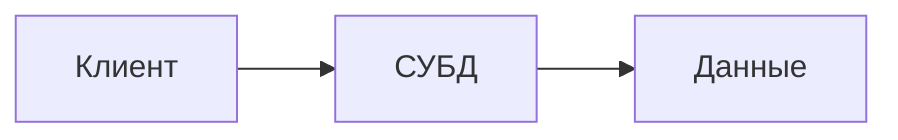

# Lecture Notes Formatting Skill

## Purpose

This skill defines how to transform raw university lecture notes into clean, readable Markdown **without turning them into a dry textbook or AI-generated summary**.

The main goal is to preserve:

- the lecturer's train of thought;
- the student's own understanding of the lecture;
- the examples, wording, emphasis, and associations present in the source;
- the natural progression of ideas.

Formatting must improve readability and structure, but it must **not replace the original voice with an impersonal academic style**.

The result should look like a carefully edited student's lecture notes, not like a generated article.

---

## Core principle

> Structure the material. Do not rewrite its personality.

When editing lecture notes, distinguish between:

1. **content reconstruction** - restoring an idea that is clearly present but written too briefly;
2. **structuring** - grouping related thoughts, adding headings, lists, tables, diagrams;
3. **content invention** - adding explanations, examples, conclusions, terminology, or facts that were not present in the lecture notes.

The first two are allowed.

The third is forbidden unless the task explicitly asks for expansion or external research. Author notes in angle brackets (`<...>`) count as explicit requests to complete the indicated content; see section 21.

---

# 1. Source of truth

The original lecture notes are the primary source of truth.

Preserve:

- the order in which the lecturer introduced ideas, when this order matters;
- examples given by the lecturer;
- unusual but meaningful analogies;
- the student's interpretation of the material;
- explicit emphasis such as `НО!`, `важно`, `проблема`, `идея`, `исключение`;
- uncertainty when the original notes themselves are uncertain.

Do not silently replace the lecture with a cleaner but conceptually different explanation.

If the notes contain:

```md
Проблема:
- Еще больше памяти
- *чет еще*
```

do not invent three additional database-theory problems merely to make the section look complete.

Instead, either preserve the incompleteness naturally or reconstruct only what is unambiguously implied by nearby material.

---

# 2. Desired writing style

The text should sound like polished lecture notes written by a technically competent student.

Prefer:

- direct explanations;
- short or medium paragraphs;
- simple transitions;
- concrete wording;
- occasional emphasis;
- lecturer examples;
- concise explanations immediately after the idea they clarify.

Avoid:

- encyclopedic prose;
- excessive formal definitions;
- generic academic filler;
- artificial introductions;
- artificial conclusions after every subsection;
- repetitive phrases such as:
  - "Таким образом..."
  - "Следовательно..."
  - "Важно отметить..."
  - "Необходимо понимать..."
  - "Данный подход..."
  - "Стоит отметить..."
  when they do not add meaning.

Do not make the text deliberately colloquial either.

The target is:

> natural technical notes, not chat speech and not a textbook.

---


# 3. No long dashes

Do not use the long dash character `—` in the generated lecture notes.

It often makes generated prose look overly polished and machine-written.

Use a normal hyphen-minus `-` instead.

Preferred:

```md
СУБД - это прослойка между клиентом и данными.
```

Avoid:

```md
СУБД — это прослойка между клиентом и данными.
```

This rule applies everywhere in generated prose:

- definitions;
- headings;
- examples;
- explanations;
- list items;
- captions;
- transitions.

Before finishing, search the edited file for `—` and replace every occurrence with `-`.

Do not replace syntax characters inside code when doing so would change program behavior. This rule concerns natural-language formatting.

---

# 4. Preserve the student's understanding

The resulting notes must reflect **how the material was understood during the lecture**, not an idealized reconstruction of the subject.

This is especially important when the original notes contain chains such as:

```text
Студент -> группа
Группа -> преподаватель

=> можно получить всех студентов преподавателя
```

A good rewrite explains exactly this connection.

Do not replace it with a broad theoretical discussion about functional dependencies, normalization, relational algebra, or ER modeling unless those ideas were actually present in the source.

The purpose is to preserve the mental model formed during the lecture.

---

# 5. Do not invent examples

Examples are part of the lecturer's explanation and should be preserved.

Exception: an author instruction such as `<пример>` or `<придумать пример>` asks the agent to create a relevant example. Follow section 21 and keep it within the lecture's subject and existing scenario.

If the original lecture contains an example with:

- студентом;
- группой;
- преподавателем;
- английским языком;
- исключением в связях;

keep that example.

Do not replace it with:

- online stores;
- bank accounts;
- warehouses;
- orders;
- abstract `User`, `Product`, `Entity`;
- other "standard" examples invented by the model.

You may add small missing details only when they are necessary to make the original example readable and are directly implied by it.

---


# 6. Formatting explicit examples

When a fragment is clearly an example, mark it explicitly in the finished notes.

Preferred format:

```md
*_Пример._* Разделение студентов по возрастам, например 17 и 18 лет. Можем инкрементировать, а можем перезаписывать и хранить, можем кэшировать и актуализировать.
```

Use exactly this visual pattern:

```md
*_Пример._*
```

followed by the example text on the same line when the example is short enough.

For a longer example, the marker may start the paragraph:

```md
*_Пример._* Пусть есть несколько студентов разных возрастов. ...
```

Rules:

- use this marker only for a real example, not for every explanation;
- preserve the lecturer's example instead of inventing a new one;
- if raw notes contain words such as `пример`, `например`, `допустим`, `пусть`, or clearly switch into a concrete scenario, consider converting that fragment to this format;
- do not create a separate `### Пример` heading for small examples;
- do not use blockquotes merely to mark examples;
- do not write `Пример:` as a dry label when the inline marker works;
- keep the example close to the concept it illustrates.

The marker exists to make scanning lecture notes easier and to clearly separate theory from a concrete case.

---

# 7. No artificial commentary blocks

Do not introduce sections or paragraphs with labels such as:

```text
Комментарий:
Пояснение:
Интерпретация:
Замечание:
Вывод:
```

unless such a label was present in the original lecture or is genuinely necessary.

Explain the point directly in the prose.

Bad:

```md
Комментарий: таблица простая для чтения, но в ней много повторов.
```

Better:

```md
В такой таблице быстро появляются повторы: студент, группа и преподаватель записываются снова для каждой дисциплины.
```

The explanation should feel like part of the notes rather than an AI annotation pasted under them.

---

# 8. Headings

Use headings to expose the structure already present in the lecture.

Recommended hierarchy:

```md
# Название лекции

## Крупная тема

### Подтема
```

Usually do not go deeper than `###`.

Do not create a heading for every small thought.

A heading is justified when:

- the lecturer switches to another concept;
- a new example begins;
- a new model/approach is considered;
- a significant comparison begins;
- the lecture clearly enters another stage.

Avoid robotic heading patterns such as:

```md
## Определение
## Основные характеристики
## Преимущества
## Недостатки
## Вывод
```

unless this structure genuinely exists in the source.

Prefer headings that name the actual idea:

```md
## Зачем вообще нужна модель данных

## Что ломается при прямом доступе к данным
```

---

# 9. Paragraphs

Use paragraphs for a single connected thought.

Do not split every sentence into a separate paragraph.

Do not combine an entire lecture into huge walls of text.

A normal paragraph usually contains 2-5 related sentences.

Short one-sentence paragraphs are acceptable when:

- the sentence carries strong emphasis;
- it acts as a transition;
- it states a key idea.

---

# 10. Lists

Use lists only when the source naturally contains a collection of items.

For ordinary bullet lists, do **not** add semicolons mechanically.

Preferred:

```md
Функции информационной системы:

- сбор
- обработка
- передача
- хранение
- представление информации
```

Avoid:

```md
- сбор;
- обработка;
- передача;
- хранение;
- представление информации.
```

Do not force every enumeration into a list.

A compact sequence can remain inline when that better matches the lecture:

```md
ИТ-продукт = код + данные + инфраструктура + процессы.
```

---

# 11. Emphasis

Use emphasis sparingly and intentionally.

Use `**bold**` for:

- key concepts;
- terminology being introduced;
- important contrasts;
- lecturer emphasis.

Use inline code for:

- identifiers;
- SQL keywords;
- commands;
- filenames;
- literal values;
- code-related notation.

Do not bold entire paragraphs.

Do not emphasize ordinary words merely to make the page look more structured.

---

# 12. Definitions

If the lecturer gives a formal definition, preserve it accurately.

If a standard or source is explicitly mentioned, preserve the attribution.

Do not transform every informal explanation into a formal definition.

For example, if the lecture distinguishes:

- сигнал;
- данные;
- знания;

it is fine to organize that distinction clearly.

But do not introduce a formal multi-level information theory framework unless the source actually contains it.

---

# 13. Tables

Use tables when the lecture compares structured records, schemas, entities, variants, or tabular data.

Prefer normal Markdown tables when possible.

Example:

```md
| студент | группа | дисциплина | преподаватель |
| --- | --- | --- | --- |
| Иванов | ПИ-23 | Базы данных | Смирнова |
```

Do not replace a simple table with large HTML unless HTML is required for a visual layout that Markdown cannot express.

## Filling empty tables

If the original notes contain an empty or partially empty table, **fill it when the surrounding lecture context provides enough information to reconstruct sensible values**.

This is an explicit exception to the general rule against inventing examples.

The values must be derived from the local lecture context:

- names, entities, identifiers, categories, or relationships already mentioned nearby;
- examples explicitly discussed by the lecturer;
- values that are directly implied by the explanation around the table;
- repeated entities from another representation of the same example.

Do not introduce unrelated realistic-looking data merely to make a table look complete.

For example, if the lecture discusses:

```text
Студент Иванов
Группа ПИ-23
Дисциплина Базы данных
Преподаватель Смирнова
```

and immediately after that contains:

```md
| студент | группа | дисциплина | преподаватель |
| --- | --- | --- | --- |
|         |        |            |               |
```

fill it as:

```md
| студент | группа | дисциплина | преподаватель |
| --- | --- | --- | --- |
| Иванов | ПИ-23 | Базы данных | Смирнова |
```

When several rows are needed, construct only as many rows as the surrounding context reasonably supports.

If context is insufficient to infer a cell safely:

- leave that cell empty;
- simplify the table if appropriate;
- or preserve the incomplete table rather than fabricating information.

The goal is not to avoid filling tables. The goal is to fill them **from context rather than from imagination**.

---

# 14. Comparisons and alternative models

When the lecturer considers several variants, preserve the comparison as a narrative.

Good structure:

```md
### Вариант 1. Одна большая таблица

...

Главная проблема здесь - повторение данных. Если одна связь изменится, ее придется исправлять сразу в нескольких местах.

### Вариант 2. Несколько дисциплин в одной строке

...

Теперь число дисциплин фактически зашивается в структуру таблицы.
```

Avoid generating identical template blocks:

```md
Преимущества:
...

Недостатки:
...

Комментарий:
...
```

for every variant.

The sections should follow the lecturer's actual reasoning.

---

# 15. Arrows and pipelines

Preserve compact chains when they help understanding.

Examples:

```text
бумажка -> Word -> таблицы -> система
```

or

```text
клиент -> СУБД -> данные
```

These may stay as inline code or be turned into a diagram if the relationship is important enough.

Do not expand every arrow chain into three paragraphs.

---

# 16. Diagrams and visual material

Visuals are encouraged when they genuinely make the lecture easier to understand.

Suitable cases:

- architecture;
- data flow;
- relationships between entities;
- processing pipeline;
- comparison of several structures;
- tree or graph relationships;
- memory layout;
- lifecycle or execution flow.

Prefer, in order:

1. a clean existing image from the course materials, if available and allowed;
2. a purpose-built diagram already present in the repository;
3. Mermaid for simple graphs and flows;
4. HTML/SVG or another project-supported format when Mermaid is visually insufficient.

Do not add diagrams merely for decoration.

A diagram must replace or clarify a relationship that would otherwise be harder to understand in prose.

When using Mermaid:

- keep node labels short;
- avoid giant graphs;
- avoid repeating the entire surrounding text inside nodes;
- prefer left-to-right direction for pipelines;
- use top-to-bottom direction for hierarchies.

Example:



If a better visual representation already exists in the repository, prefer it over generating another Mermaid diagram.

---

# 17. Images

Images should have instructional value.

Use them for:

- a lecturer's slide or scheme that is hard to reproduce;
- architecture;
- complex diagrams;
- geometric or spatial objects;
- visual comparisons.

Do not add generic stock images or decorative illustrations.

If no appropriate image exists, keep the section textual rather than inserting irrelevant visuals.

---

# 18. Mathematical material

For math-heavy lectures:

- preserve the lecturer's notation whenever possible;
- do not rename variables without a reason;
- keep the order of derivation;
- separate formulas from prose when formulas are important;
- use inline formulas for short expressions;
- use display formulas for central derivations.

Do not skip intermediate transformations that were important to the student's understanding.

At the same time, do not artificially expand obvious algebra.

A lecture note should preserve the useful reasoning path.

---

# 19. Programming material

For programming lectures:

- preserve code examples from the lecture;
- fix obvious formatting problems;
- do not silently rewrite the code into a different style or architecture;
- preserve identifiers when they matter to the explanation;
- keep code close to the paragraph that explains it.

Do not replace simple lecturer code with "production-quality" abstractions.

The purpose is to explain the lecture, not refactor the lecturer's codebase.

---

# 20. Terminology

Preserve the terminology used in the course.

If the lecturer uses both a formal and informal term, it is fine to keep both.

Example:

```md
СУБД - это прослойка между клиентом и данными.
```

can be more useful in notes than replacing the word "прослойка" with a long formal description.

Introduce a formal term when it helps map the lecturer's wording to standard terminology, but do not let the formal term erase the original explanation.

---

# 21. Handling incomplete notes

### Angle brackets are instructions to the agent

The author uses angle brackets (`<...>`, also called "треугольные скобки") to request completion by the agent, not to mark gaps for preservation. Examples include `<пример>`, `<добавить конкретики>`, `<... + пример>` and `<... чет записать>`. A clearly intended author instruction with a missing closing bracket has the same meaning; infer its end from the next independent paragraph or list item.

Complete these requests directly: supply the explanation, definition, example, table values, code or missing list item that fits the surrounding topic. This is explicit authorization to supplement that fragment and overrides the default restrictions on adding examples, theory and table data. It does not authorize unrelated expansion. Literal HTML/XML tags, code syntax, generics and mathematical comparisons are not author instructions.

Replace each marker with finished material. Do not substitute "не записано", "пример отсутствует" or a TODO for a request that can be completed. Use existing entities and notation first; choose consistent illustrative values where the requested example needs them. Never present newly created values or wording as recovered lecturer material.

Check technical additions against reliable primary sources when needed. Integrate them into readable notes; a single brief provenance note and relevant source links can distinguish the additions without labeling every paragraph. If a requested historical fact, quotation or specific lecturer example cannot be established, state that narrow uncertainty instead of fabricating it.

### Other incomplete fragments

Raw notes often contain unfinished fragments.

Examples:

```text
знания -
```

```text
*чет еще*
```

```text
концепция плохая (т.к. ...)
```

Handle them carefully.

### Allowed

Restore missing wording when it is unambiguously recoverable from:

- nearby notes;
- another version of the same lecture;
- a lecturer slide provided as a source;
- an explicitly allowed source.

### Not allowed

Invent a complete explanation solely because it would be theoretically correct.

If the missing content cannot be reconstructed safely:

- keep the statement modest;
- remove obviously meaningless placeholder text only if doing so does not hide an important gap;
- optionally leave a concise `TODO`, if the project convention allows it.

Do not conceal uncertainty by generating confident prose.

---

# 22. External knowledge

By default, do not use external knowledge to expand lecture notes.

External knowledge may be used only when the task explicitly asks to:

- verify;
- research;
- supplement;
- add references;
- clarify missing theory.

Author instructions in angle brackets (section 21) are such requests within the scope of the marked fragment.

When external material is used, clearly distinguish it from the lecturer's material.

The lecture notes themselves must remain centered on the course source.

---

# 23. Sources

Do not append a generic "Источники" section automatically.

Add a sources section only if:

- sources were present in the original material;
- the task explicitly asks for references;
- external material was actually used;
- the repository convention requires it.

Do not fabricate authoritative-looking references merely to make the notes look academic.

---

# 24. Introductions and conclusions

Do not automatically add:

```md
## Введение
```

or

```md
## Итог
```

to every lecture.

Add an introduction only when the lecture genuinely begins with an overview that benefits from preservation.

Add a final summary only when:

- the lecturer summarized the lecture;
- the raw notes contain a conclusion;
- a short summary materially improves navigation through a long lecture.

Never generate a generic textbook-style conclusion just because the document has ended.

---

# 25. Editing intensity

Prefer the **minimum transformation necessary**.

The editing priority is:

1. fix broken formatting;
2. restore obvious structure;
3. make fragments readable;
4. connect ideas that clearly belong together;
5. add diagrams/tables where useful;
6. lightly clarify wording;
7. stop.

Do not keep "improving" the document after it is already clear.

More polished is not always better.

---

# 26. What must not happen

Do not:

- turn notes into an encyclopedia article;
- add examples without authorization (angle-bracket requests are authorization);
- invent facts;
- invent lecturer explanations;
- overformalize informal lecture language;
- add repetitive "Комментарий" blocks;
- add generic conclusions;
- add semicolons to every list item;
- add headings for every paragraph;
- make every section follow the same template;
- replace all arrow diagrams with verbose prose;
- create decorative diagrams;
- fill empty tables with arbitrary data unrelated to the lecture context;
- silently change the conceptual order;
- erase the student's own mental model;
- make the notes sound uniformly AI-generated;
- use the long dash character `—` in natural-language text;
- leave an empty example table unfilled when its values can be reconstructed safely from the surrounding lecture context.

---

# 27. Self-check before finishing

Before finalizing the edited lecture, check the following.

### Fidelity

- Did I preserve the lecturer's main examples?
- Did I preserve the original train of thought?
- Did I accidentally introduce a new example?
- Did I add theoretical material that was not present in the source?
- Does the result still reflect how the lecture was understood?
- Have all author instructions in angle brackets been completed, without mistaking literal syntax for an instruction or leaving avoidable gap notices?

### Style

- Does the text sound like edited student notes rather than a textbook?
- Are there unnecessary formal transitions?
- Are there repetitive `Комментарий`, `Пояснение`, `Вывод` blocks?
- Are lists punctuated naturally rather than mechanically?
- Are paragraphs reasonably sized?
- Is there any `—` character left in natural-language text?
- Are concrete examples consistently marked with `*_Пример._*` where appropriate?

### Structure

- Are headings useful rather than excessive?
- Are tables used only where they improve structure?
- Are diagrams actually helpful?
- Is any diagram duplicating the surrounding prose?
- Can any complex HTML be replaced with simpler Markdown?
- Were empty tables filled from context wherever the surrounding notes provided enough information?

### Restraint

Ask:

> If I remove this sentence, example, heading, diagram, or section, do the notes lose something that was actually present or necessary for understanding?

If the answer is no, remove it.

---

# 28. Working procedure

When asked to format a lecture file:

1. Read the original notes completely before editing.
2. Identify the lecturer's main sequence of ideas.
3. Identify examples that must be preserved.
4. Identify fragments that are incomplete or ambiguous. Treat author instructions in angle brackets as completion tasks under section 21, including clearly unfinished markers.
5. Build only the minimum useful heading structure.
6. Rewrite fragments into connected prose while preserving the original meaning.
7. Convert genuine enumerations into lists.
8. Keep compact chains compact.
9. Fill empty or partial tables from the lecture context when the values can be reconstructed safely.
10. Mark concrete examples with `*_Пример._*` where appropriate.
11. Add tables or diagrams only when they improve understanding.
12. Remove robotic phrasing introduced during editing.
13. Search for and remove all long dashes `—` from natural-language text.
14. Compare the result against the original.
15. Ensure that no unrelated invented example or theory has silently entered the document.

If an already formatted version exists, treat the task as an edit rather than a full rewrite:

- keep good structure;
- remove dry or invented passages;
- restore original examples and thought process;
- simplify over-engineered formatting.

---

# 29. Target result

The final lecture should feel as if the student:

1. attended the lecture;
2. wrote rough notes during it;
3. later sat down and carefully organized those notes;
4. restored obvious missing connections;
5. added a few genuinely useful diagrams;
6. did **not** replace the lecture with a generated textbook chapter.

That is the target style.
