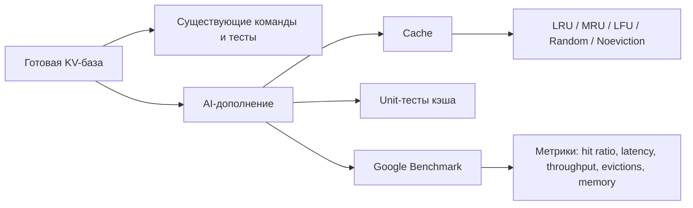
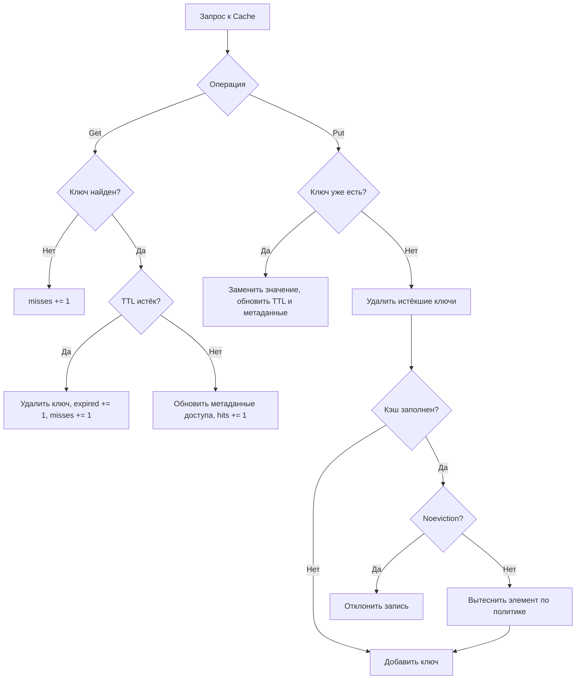
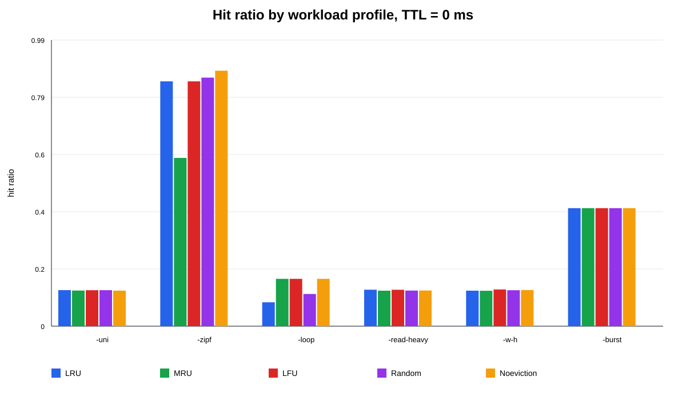
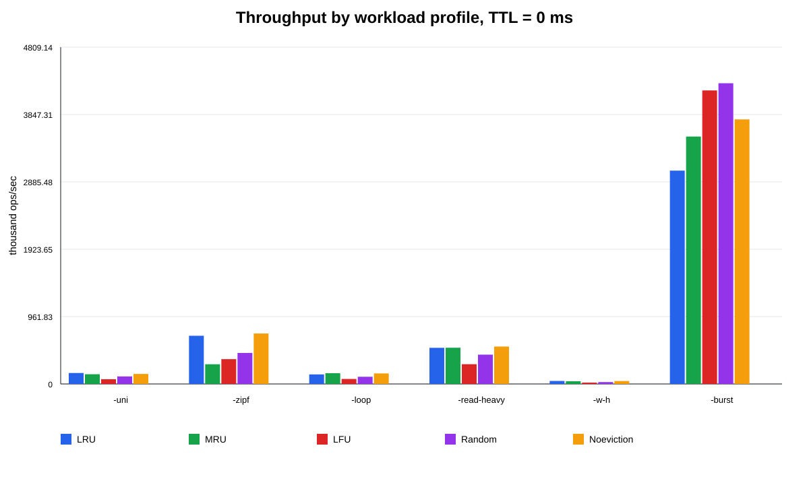
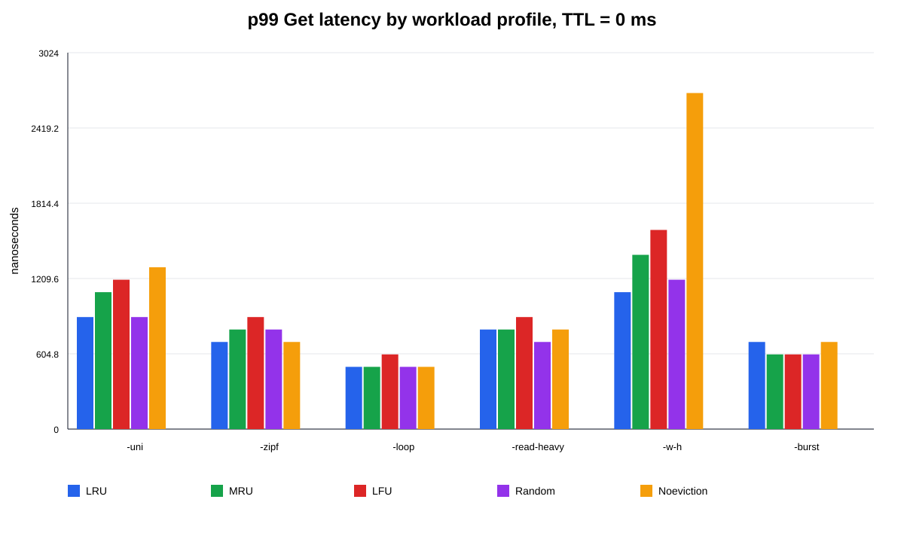
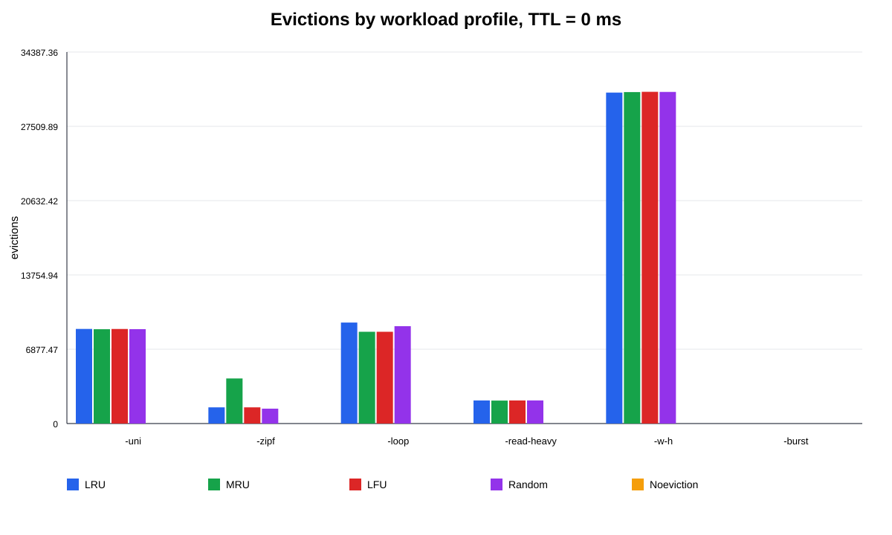

# Отчёт по исследовательскому дополнению к лабораторной работе

  

**Тема:** сравнение политик вытеснения в однопоточном in-memory кэше на различных профилях нагрузки.

  

**Базовый проект:** готовая key-value база данных, реализованная ранее в рамках лабораторной работы.

  

**Характер дополнения:** функциональность, тесты, бенчмарки и отчётная часть были подготовлены с использованием нейронной сети как AI-дополнение к уже существующей лабораторной работе.

  

## Аннотация

  

В работе рассматривается задача расширения готовой key-value базы данных исследовательским модулем in-memory кэша. Цель дополнения состоит не в замене исходной реализации базы данных, а в создании отдельного слоя для сравнения политик вытеснения на разных профилях нагрузки.

  

В ходе работы был добавлен однопоточный кэш с поддержкой TTL, метрик и политик вытеснения `LRU`, `MRU`, `LFU`, `Random`, `Noeviction`. Также были реализованы unit-тесты и Google Benchmark-сценарии для профилей `Uniform`, `Zipf`, `Sequential Loop`, `Read-Heavy`, `Write-Heavy` и `Burst`.

  

Особенность работы состоит в том, что основная лабораторная была написана заранее вручную, а исследовательское расширение было сгенерировано и доработано с помощью нейронной сети. Поэтому в отчёте отдельно рассматриваются не только алгоритмы и результаты, но и роль ИИ в разработке программного дополнения.

  

## Артефакты работы

  

В ходе работы были получены следующие артефакты, на которые можно ссылаться при защите и при проверке проекта:

  

| Артефакт | Файл | Назначение |

|---|---|---|

| Интерфейс кэша | `include/cache/cache.hpp` | Описание `Cache`, `CacheConfig`, `CacheStats`, списка политик вытеснения |

| Реализация кэша | `src/cache/cache.cpp` | Алгоритмы `Get`, `Put`, TTL и вытеснения |

| Unit-тесты | `tests/cache_ut.cpp` | Проверка LRU, MRU, LFU, Random, Noeviction, TTL и метрик |

| Benchmark-сценарии | `benchmarks/cache_benchmarks.cpp` | Генерация профилей нагрузки и регистрация Google Benchmark |

| Результаты benchmark-прогона | `artifacts/cache_benchmark_results.csv` | Таблица измерений, используемая для анализа |

| Графики | `artifacts/*.svg` | Визуализация hit ratio, throughput, p99 latency и количества вытеснений |

  

В итоговом PDF эти пути не предполагаются как кликабельные ссылки. Они приведены как идентификаторы артефактов, чтобы было понятно, какие материалы были созданы в ходе работы. Диаграммы и графики вставляются в текст отчёта как изображения.

  

Отдельным артефактом является история уточнений требований: сначала был создан потокобезопасный вариант кэша, затем по требованию работа была упрощена до однопоточной реализации; после этого были исправлены имена benchmark-профилей и добавлена политика `MRU`.

  

## 1. Введение

  

Кэширование является одним из распространённых способов повышения производительности систем хранения данных. Если данные часто читаются повторно, их можно временно хранить в более быстром хранилище. В данной работе таким хранилищем является in-memory кэш, работающий поверх или рядом с key-value базой данных.

  

Основная проблема кэша связана с ограничением размера. Если количество элементов превышает допустимую ёмкость, необходимо выбрать, какие данные удалить. Для этого применяются политики вытеснения. От выбора политики зависит hit ratio, задержка операций, пропускная способность и стабильность поведения системы при разных типах нагрузки.

  

Цель работы: подготовить исследовательское дополнение к существующей key-value базе данных и сравнить поведение разных политик вытеснения в кэше.

  

Задачи работы:

  

- реализовать отдельный модуль in-memory кэша;

- добавить политики вытеснения `LRU`, `MRU`, `LFU`, `Random`, `Noeviction`;

- реализовать TTL для записей кэша;

- добавить сбор метрик;

- подготовить unit-тесты;

- подготовить Google Benchmark-сценарии;

- проверить, что существующие тесты лабораторной работы не сломались;

- оформить результат в виде отчёта.

  

Из исходного расширенного технического задания была исключена многопоточность. Поэтому текущая реализация кэша является однопоточной и не содержит `std::mutex`, `std::thread`, `std::atomic`.

  

## 2. Обзор предметной области

  

### 2.1. Проблема вытеснения данных из кэша

  

Кэш имеет ограниченную ёмкость. Если в него добавляется новый элемент, а свободного места нет, система должна принять решение: удалить один из старых элементов или отказаться от добавления нового. Это решение определяет политика вытеснения.

  

Неподходящая политика может привести к низкому hit ratio. Например, если кэш удаляет данные, которые скоро снова понадобятся, количество промахов возрастает. В результате система чаще обращается к основному хранилищу, а задержка операций увеличивается.

  

### 2.2. Политики вытеснения

  

**LRU (Least Recently Used)** удаляет элемент, который дольше всех не использовался. Политика основана на предположении временной локальности: если объект использовался недавно, он может понадобиться снова.

  

**MRU (Most Recently Used)** удаляет самый недавно использованный элемент. Такая политика полезна не всегда, но может быть интересна для сравнения в циклических или сканирующих сценариях, где недавно прочитанный элемент может долго не понадобиться повторно.

  

**LFU (Least Frequently Used)** удаляет элемент с минимальным числом обращений. Политика учитывает популярность ключей и может быть эффективна при неравномерном распределении запросов.

  

**Random** удаляет случайный элемент. Главное преимущество политики — простота. Она не хранит сложные метаданные доступа, но и не использует информацию о поведении ключей.

  

**Noeviction** не удаляет элементы. Если кэш заполнен, новая запись отклоняется. Такая политика соответствует режиму, при котором важнее сохранить уже находящиеся в кэше данные, чем автоматически освобождать место.

  

### 2.3. Профили нагрузки

  

**Uniform (`-uni`)** — равномерное распределение запросов по ключам. Такой профиль моделирует ситуацию, где нет явно популярных элементов.

  

**Zipf (`-zipf`)** — неравномерное распределение, при котором небольшая часть ключей получает большую долю запросов. Такой профиль часто ближе к реальным системам: популярные товары, страницы, пользователи или документы читаются значительно чаще остальных.

  

**Sequential Loop (`-loop`)** — циклический последовательный обход ключей. Такой профиль моделирует сканирование или пакетную обработку.

  

**Read-Heavy (`-read-heavy`)** — профиль с преобладанием операций чтения. Он характерен для справочников, каталогов, конфигураций и read-mostly сервисов.

  

**Write-Heavy (`-w-h`)** — профиль с преобладанием операций записи. В таком сценарии кэш чаще обновляется, а выгода от повторного чтения может быть ниже.

  

**Burst (`-burst`)** — профиль со всплесками обращений к горячему подмножеству ключей. Он моделирует ситуации, когда нагрузка временно концентрируется на небольшой группе данных.

  

## 3. Реализация

  

### 3.1. Общая структура дополнения

  

В проект были добавлены следующие файлы:

  

- `include/cache/cache.hpp` — интерфейс кэша;

- `src/cache/cache.cpp` — реализация кэша;

- `tests/cache_ut.cpp` — unit-тесты;

- `benchmarks/cache_benchmarks.cpp` — Google Benchmark-сценарии;

- `benchmarks/CMakeLists.txt` — сборка benchmark-цели;

- изменения в `CMakeLists.txt`, `src/CMakeLists.txt`, `tests/CMakeLists.txt`.

  

Кэш реализован как отдельный класс `Cache`. Он не заменяет существующий класс `DataBase` и не меняет поведение старых команд `SET`, `GET`, `EXPIRE` и других. Это сделано намеренно: дополнение является исследовательским модулем, который можно тестировать и измерять отдельно, не ломая уже готовую лабораторную работу.

  

Схема места нового модуля в проекте:

  



  

### 3.2. Интерфейс

  

Пример создания кэша:

  

```cpp

CacheConfig config;

config.capacity = 4096;

config.policy = EvictionPolicy::Lru;

config.ttl = std::chrono::milliseconds(1000);

  

Cache cache(config);

```

  

Основные операции:

  

```cpp

cache.Put("key", "value");

auto value = cache.Get("key");

cache.Erase("key");

cache.Clear();

CacheStats stats = cache.Stats();

```

  

Собираемые метрики:

  

- `hits` — количество успешных чтений;

- `misses` — количество промахов;

- `puts` — количество успешных записей;

- `rejected_puts` — количество отклонённых записей;

- `evictions` — количество вытеснений;

- `expired` — количество удалений по TTL;

- `memory_estimate` — приблизительная оценка памяти;

- `HitRatio()` — отношение `hits / (hits + misses)`.

  

### 3.3. Псевдокод основных операций

  

#### Операция Get

  

```text

function Get(key):

    if key not in cache:

        misses += 1

        return null

  

    if key is expired:

        remove key

        expired += 1

        misses += 1

        return null

  

    update access metadata

    hits += 1

    return value

```

  

#### Операция Put

  

```text

function Put(key, value):

    if key exists:

        replace value

        update ttl

        update access metadata

        puts += 1

        return true

  

    purge expired keys

  

    if cache is full:

        if policy == Noeviction:

            rejected_puts += 1

            return false

        else:

            EvictOne()

  

    insert key

    puts += 1

    return true

```

  

Диаграмма выполнения операций `Get` и `Put`:

  



  

### 3.4. Псевдокод политик вытеснения

  

#### LRU

  

```text

on successful Get or Put:

    move key to the front of access list

  

on eviction:

    remove key from the back of access list

```

  

#### MRU

  

```text

on successful Get or Put:

    move key to the front of access list

  

on eviction:

    remove key from the front of access list

```

  

#### LFU

  

```text

on successful Get or Put update:

    frequency += 1

    last_access = current logical time

  

on eviction:

    choose key with minimal frequency

    if several keys have equal frequency:

        choose key with older last_access

```

  

#### Random

  

```text

on eviction:

    choose random key from cache

    remove it

```

  

#### Noeviction

  

```text

on inserting new key:

    if cache is full:

        reject insert

    else:

        insert key

```

  

### 3.5. Соответствие техническому заданию

  

Выполнено:

  

- реализован in-memory кэш;

- реализованы `LRU`, `LFU`, `Random`, `Noeviction`;

- дополнительно реализована `MRU`;

- реализован TTL;

- реализованы метрики;

- реализованы бенчмарки с профилями нагрузки;

- добавлены unit-тесты.

  

Исключено по текущему решению:

  

- многопоточность;

- параметры количества потоков чтения и записи;

- тесты на race condition.

  

Пока не интегрировано:

  

- кэш не подключён к пользовательскому командному интерфейсу основной KV-базы;

- не добавлены команды вида `CACHE GET`, `CACHE SET`, `CACHE CONFIG`;

- не выполнен полный экспериментальный прогон по всем комбинациям.

  

## 4. Эксперименты

  

### 4.1. Инструментарий

  

Для тестирования корректности используется Google Test. Для измерения производительности используется Google Benchmark.

  

Обычная сборка и запуск тестов:

  

```bash

cmake -S . -B build -DBUILD_BENCHMARKS=OFF

cmake --build build --config Debug

ctest --test-dir build --output-on-failure

```

  

Сборка benchmark-цели:

  

```bash

cmake -S . -B build-bench -DBUILD_TESTS=OFF -DBUILD_BIN=OFF -DBUILD_BENCHMARKS=ON

cmake --build build-bench --config Debug

```

  

Просмотр доступных бенчмарков:

  

```powershell

build-bench\bin\cache_benchmarks.exe --benchmark_list_tests

```

  

Пример запуска одного профиля:

  

```powershell

build-bench\bin\cache_benchmarks.exe --benchmark_filter=Cache/-zipf/LRU --benchmark_min_time=1x --benchmark_repetitions=1

```

  

### 4.2. Реализованные benchmark-профили

  

В коде зарегистрированы следующие имена:

  

- `Cache/-uni/...`;

- `Cache/-zipf/...`;

- `Cache/-loop/...`;

- `Cache/-read-heavy/...`;

- `Cache/-w-h/...`;

- `Cache/-burst/...`.

  

Для каждого профиля регистрируются политики:

  

- `LRU`;

- `MRU`;

- `LFU`;

- `Random`;

- `Noeviction`.

  

Используемые параметры по умолчанию:

  

- размер кэша: `4096`;

- пространство ключей: `32768`;

- количество операций: `50000`;

- TTL: `0 ms` и `1000 ms`.

  

### 4.3. Метрики эксперимента

  

В benchmark-вывод добавлены следующие показатели:

  

- `hit_ratio`;

- `throughput_ops_sec`;

- `p50_get_ns`;

- `p99_get_ns`;

- `evictions`;

- `memory_estimate`.

  

Эти метрики позволяют сравнивать политики не только по скорости, но и по качеству удержания полезных данных в кэше.

  

### 4.4. Графики и визуализация результатов

  

Для отчёта были построены графики на основе реального прогона Google Benchmark в Release-сборке. Результаты сохранены в `artifacts/cache_benchmark_results.json` и дополнительно преобразованы в таблицу `artifacts/cache_benchmark_results.csv`.

  

В PDF-версии отчёта графики должны быть вставлены как изображения. В Markdown они подключены следующим образом:

  



  



  



  



  

Для визуализации использованы результаты при `TTL = 0 ms`, чтобы сравнение отражало именно влияние политики вытеснения, а не дополнительное удаление записей по времени жизни.

  

### 4.5. Проверка корректности

  

После добавления кэша и изменения benchmark-имён были выполнены сборка и тестирование проекта. Все unit-тесты прошли успешно.

  

После добавления политики `MRU` итоговый результат тестирования составил:

  

```text

255/255 tests passed

```

  

Это означает, что добавленное AI-дополнение не нарушило существующие тесты основной лабораторной работы.

  

### 4.6. Интерпретация ожидаемых результатов

  

Для `Uniform` ожидается сравнительно низкий hit ratio, потому что доступ равномерно распределён по большому пространству ключей.

  

Для `Zipf` ожидается рост hit ratio у `LRU` и `LFU`, потому что часть ключей становится горячей и повторно используется.

  

Для `Sequential Loop` возможна ситуация, при которой `MRU` покажет интересный результат, так как недавно использованный элемент при циклическом проходе может не понадобиться повторно в ближайшее время.

  

Для `Read-Heavy` кэш должен быть наиболее полезен, потому что чтения преобладают над записями.

  

Для `Write-Heavy` hit ratio может снижаться из-за частых обновлений и вытеснений.

  

Для `Burst` важна способность политики быстро адаптироваться к временному горячему набору ключей.

  

## 5. Результаты

  

В результате работы было создано AI-дополнение к готовой лабораторной:

  

- добавлен модуль однопоточного кэша;

- реализованы политики `LRU`, `MRU`, `LFU`, `Random`, `Noeviction`;

- реализован TTL;

- добавлен сбор метрик;

- добавлены unit-тесты;

- добавлены Google Benchmark-профили;

- исправлены имена benchmark-профилей на соответствующие смыслу ТЗ, включая `-zipf` и `-read-heavy`;

- существующая база данных не была переписана.

  

Главный результат состоит в том, что вокруг уже готовой KV-базы появился отдельный экспериментальный слой. Его можно использовать для сравнения политик вытеснения без риска изменить семантику старых команд.

  

По результатам Release-прогона benchmark-ов при `TTL = 0 ms` были получены следующие лучшие значения по `hit_ratio` для каждого профиля:

  

| Профиль нагрузки | Лучшая политика по hit ratio | Hit ratio | Throughput, ops/sec | p99 Get, ns | Evictions |

|---|---|---:|---:|---:|---:|

| `-uni` | LRU | 0.1251 | 156548 | 900 | 8757 |

| `-zipf` | Noeviction | 0.8863 | 720432 | 700 | 0 |

| `-loop` | Noeviction | 0.1642 | 150414 | 500 | 0 |

| `-read-heavy` | LRU | 0.1265 | 516121 | 800 | 2138 |

| `-w-h` | LFU | 0.1274 | 19628 | 1600 | 30703 |

| `-burst` | все политики дали одинаковый hit ratio | 0.4094 | до 4293873 | 600-700 | 0 |

  

Эти результаты показывают, что универсально лучшей политики не существует. Например, на `Zipf` высокий результат даёт `Noeviction`, так как начальный набор ключей хорошо покрывает горячую часть распределения. На `Write-Heavy` по hit ratio лучшей оказалась `LFU`, но при этом она имеет меньший throughput, что показывает компромисс между качеством удержания ключей и стоимостью обслуживания политики.

  

## 6. Обсуждение

  

Данная работа отличается от обычной реализации лабораторной тем, что основной акцент сделан на использовании нейронной сети. Базовая лабораторная работа уже существовала, а ИИ применялся для генерации нового функционального слоя: кэша, тестов, бенчмарков и структуры отчёта.

  

Такой подход имеет преимущества:

  

- быстрее создаётся первичный вариант реализации;

- проще добавить однотипные тесты;

- проще сгенерировать основу отчёта;

- можно быстро проверить несколько вариантов архитектуры.

  

Однако у подхода есть ограничения:

  

- сгенерированный код всё равно нужно проверять;

- ИИ может неверно интерпретировать формулировку ТЗ;

- часть решений нужно корректировать вручную;

- отчёт требует ручной смысловой правки;

- экспериментальные результаты нельзя выдумывать, их нужно получать реальным запуском benchmark-ов.

  

В данной работе это проявилось явно: сначала был создан потокобезопасный вариант, затем по уточнению требований он был переделан в однопоточный. Также были исправлены имена benchmark-профилей и добавлена политика `MRU`.

  

### 6.1. След использования ИИ

  

Так как смысл данной работы состоит в создании дополнения к готовой лабораторной с помощью нейронной сети, в отчёте фиксируется последовательность действий ИИ:

  

1. Был изучен существующий проект: структура `include`, `src`, `tests`, CMake-файлы и уже реализованный класс `DataBase`.

2. Было принято решение не переписывать основную KV-базу, а добавить отдельный модуль `Cache`, чтобы снизить риск поломки старой лабораторной.

3. Первоначально был создан потокобезопасный вариант кэша, соответствующий исходному расширенному ТЗ.

4. После уточнения требований многопоточность была удалена: из кода убраны `mutex`, `thread`, `atomic`, а класс стал однопоточным.

5. Были реализованы политики `LRU`, `LFU`, `Random`, `Noeviction`.

6. После дополнительного уточнения была добавлена политика `MRU`.

7. Были добавлены unit-тесты, проверяющие поведение политик, TTL и метрик.

8. Были добавлены Google Benchmark-профили `-uni`, `-zipf`, `-loop`, `-read-heavy`, `-w-h`, `-burst`.

9. Были исправлены ошибочные имена профилей: `-2ipf` заменено на `-zipf`, `-road-heavy` заменено на `-read-heavy`.

10. Был создан и затем доработан отчёт: добавлены артефакты, псевдокод, схемы, описание роли ИИ и проверка последовательности текста.

  

Таким образом, ИИ выступал не только как генератор кода, но и как инструмент итеративной доработки: после каждого уточнения требований структура проекта и отчёта приводилась к более подходящему виду.

  

### 6.2. Последовательность текста отчёта

  

Структура отчёта выстроена от общего к частному:

  

1. Сначала формулируются тема, аннотация и назначение работы.

2. Затем перечисляются артефакты, чтобы сразу было понятно, какие файлы были добавлены.

3. После этого описывается предметная область: проблема кэша, политики вытеснения и профили нагрузки.

4. Далее идёт реализация: структура кода, интерфейс, псевдокод и схемы.

5. Затем описываются эксперименты: инструменты, benchmark-профили, метрики и способ вставки графиков.

6. После этого фиксируются результаты и обсуждается роль ИИ.

7. В конце формулируется заключение и направления дальнейшей доработки.

  

Такой порядок позволяет сначала объяснить, зачем было нужно дополнение, затем показать, что именно было создано, и только после этого обсуждать эксперименты и выводы.

  

## 7. Заключение

  

В ходе работы было подготовлено исследовательское дополнение к существующей key-value базе данных. Реализованный кэш позволяет сравнивать разные политики вытеснения на нескольких профилях нагрузки и собирать основные метрики качества.

  

Работа не претендует на полную замену исходной лабораторной. Её смысл состоит в демонстрации того, как с помощью нейронной сети можно расширить уже готовый учебный проект: добавить экспериментальный модуль, тесты, benchmark-инфраструктуру и основу аналитического отчёта.

  

Дальнейшее развитие работы:

  

- выполнить полный прогон benchmark-ов в Release-сборке;

- собрать таблицу результатов по всем политикам и профилям;

- добавить статистическую обработку повторов;

- при необходимости встроить кэш в командный интерфейс основной KV-базы;

- дополнить отчёт списком источников и финальным анализом экспериментальных данных.