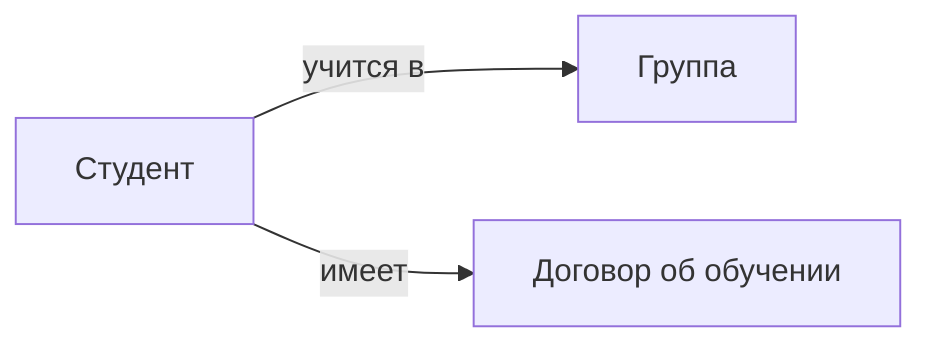

# Вторая лекция. СУБД, структурирование данных и модели данных

## СУБД

**СУБД** не просто управляет БД: она хранит ее схему, управляет доступом и контролирует чтение и запись данных.

СУБД также берет на себя оптимизацию доступа к данным. Это особенно важно в высоконагруженных системах, хотя на деле многое зависит и от SQL-запроса, который программист может писать хоть неделю.

## Структурирование данных

Для оптимального хранения возникает вопрос о модели: как хранить данные - в виде графа, массива, пары «ключ - указатель»?

Структура данных влияет на операции над данными. При частом чтении хочется сделать доступ константным или амортизировать операции поиска.

*_Пример._* Здесь рассматривалось сбалансированное бинарное дерево.

### Проблема чтения и записи

Самая главная проблема - чтение и запись. Нужен баланс между этими операциями.

*_Пример._* При записи в `std::vector` запись будет за амортизированную константу, но чтение - за линию.

Можно хранить данные упорядоченно. Тогда бинарным поиском можно читать за `O(log n)`, но запись будет сложной: нужно найти место для записи и вставить за линию.

*_Пример._* БД со студентами можно хранить в виде хэша, например по фамилии. Но тогда одна ошибка будет разрушать БД.

Оптимального баланса между чтением и записью нет. Поэтому нужна специальная архитектура, которая помогает находить баланс между операциями.

### Разработка оптимальной архитектуры

*_Пример._* Дом - не просто коробка с окнами. Построить коробку легко; главная проблема - оптимально продумать канализацию, электрику и другие части архитектуры. Для электрики нужно не только понять, как ее проложить, но и сделать это дешево. Этим должен заниматься электрик.

*_Пример._* В Бурдж-Халифе нужно отдельно продумывать подъем воды на верхние этажи.

Устройство данных и архитектуру нужно стандартизировать. Но один человек не способен контролировать все аспекты, поэтому уровни ответственности разделяют.

## Стандарт ANSI/SPARC

В стандарте разделяют **три** уровня.

### Внешний уровень

Представление БД с точки зрения конечного пользователя. Это уровень работы с потребителем.

*_Пример._* Студентов можно разделить по возрастам, например на 17- и 18-летних. Возраст можно инкрементировать, перезаписывать и хранить, можно кэшировать и актуализировать.

На внешнем уровне думают, как агрегировать данные. Не нужно думать о внутренней структуре и о том, что там происходит: нужно просто получать информацию, причем разную для разных пользователей.

### Концептуальный уровень

Уровень, на котором решают, как организовать данные, и выделяют **сущности** и **атрибуты**.

*_Пример._* У студента есть свойство быть ментором, а оно тянет за собой набор других свойств. В одной таблице это неэффективно: менторов около 5%, поэтому в большинстве строк будет `NULL`. Если вынести ментора в отдельную сущность, появляется проблема неконсистентности: отчисленный студент не может быть ментором, значит нужна проверка.

*_Пример._* Оценки можно хранить числами и сортировать. Но тогда нужен справочник, где зафиксировано, что оценка 5 лучше оценки 4.

Этот уровень также нужен для валидации данных, например разных номеров телефонов.

### Внутренний уровень

Инфраструктура и работа с железом. Здесь определяют структуру данных и индексацию.

*_Пример._* Старые сообщения VK можно хранить в сжатом виде.

## Типы моделей данных

- модель «сущность - связь» - пересечение внешнего и концептуального уровней, модель, отражающая реальную модель
- логическая модель - концептуальный уровень, структуры данных
- физическая модель - пересечение концептуального и внутреннего уровней, выбор конкретного ПО

## Модель «сущность - связь»

Модель «сущность - связь» = ER-diagram.

### Сущность

**Сущность** - объект, о котором нужно хранить данные. Выделяя сущности, архитектор данных должен смотреть вперед, чтобы модель можно было расширять. Это крайне важно.

- Сильная сущность - ее экземпляр *может* существовать без связи с другими сущностями.

- Слабая сущность - ее экземпляр *не может* существовать без связи с другими сущностями.

*_Пример._* Сущности «Студент» и «Договор об обучении». Студент - сильная сущность, а договор - слабая: договор не существует без студента.

### Свойства (атрибуты)

**Атрибуты** - свойства сущности.

Виды атрибутов:

- обязательный
- вариативный
- многозначный

Каждый атрибут принадлежит **домену** - области допустимых значений.

*_Пример._* Сущность «Студент» имеет атрибут «Адрес». Это составной атрибут: он разбивается на улицу, дом и т.д.

*_Пример._* Табельный номер - обязательный атрибут. У студента может не быть фамилии, но табельный номер быть должен.

### Связь

Типы связей:

- **1 : 1** - такую связь можно отнести к свойствам
- **1 : n** - одной сущности соответствует несколько экземпляров другой
- **m : n** - нескольким экземплярам одной сущности соответствуют несколько экземпляров другой

*_Пример._* Группа как сущность - слабая или сильная? Если студент учится на двух образовательных программах, реляционная модель не справится.

### Нотация Чена

В нотации Чена сущности показывают прямоугольниками, связи - ромбами, а атрибуты - овалами.
