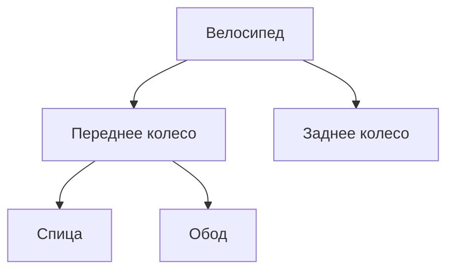

# Третья лекция. Логические модели данных

*Конспект дополнен по авторским пометкам. Числовые данные и развернутые примеры подобраны для объяснения; ссылки ведут к источникам уточнений.*

## Физическое представление

Физически имеем **память** - линейно адресуемое пространство. Пока не важно, с какой адресацией.

## Иерархическая модель данных

*_Пример._* Строим модель библиотеки: есть некоторое количество книг, которые хотим классифицировать, разбить на кластеры и т.п.

Здесь возникают две задачи: разбиение на **классы эквивалентности**, которые не пересекаются, или выделение **классов толерантности**, которые могут пересекаться. Дерево удобно для последовательного разбиения на непересекающиеся группы.

*_Пример._* Разбиваем книги на жанры, поджанры и т.д.

Но у дерева есть ограничение: **у потомка должен быть только один родитель**. Если книга относится сразу к нескольким жанрам, поместить один и тот же экземпляр записи в несколько ветвей уже не получится. Такая структура связей характерна для иерархической модели. [IBM: типы баз данных](https://www.ibm.com/think/topics/database).

*_Пример._* Дивизионная модель управления в бизнесе: `генеральный директор -> заместитель директора -> ...`.

*_Пример._* Изделие состоит из компонентов, а компоненты - из деталей. Возьмем велосипед с передним и задним колесами. Значения стоимости, массы и марки здесь условные.

| изделие | название | стоимость, руб. |
| --- | --- | --- |
| 1 | Велосипед | 30000 |

| компонент | марка | вес, кг |
| --- | --- | --- |
| Переднее колесо | К-1 | 1,2 |
| Заднее колесо | К-2 | 1,5 |

| деталь | марка | материал |
| --- | --- | --- |
| Спица | С-1 | Сталь |
| Обод | О-1 | Алюминий |



В рассматриваемом способе реализации деталь имеет **указатель** (`pointer`) на родителя, который тоже лежит в памяти. Память при этом линейна. Это иллюстрация реализации связей, а не обязательный физический формат любой иерархической СУБД.

Условная запись структуры:

```text
struct Item {
    pointer ItemOrigin;
    data;
};
```

### Проблемы иерархической модели

1. **Жесткая структура связей.** В чистом дереве запись принадлежит одной ветви. Если описание одной марки спицы нужно обоим колесам, придется дублировать его или вводить дополнительные связи за пределами дерева.
2. **Проблема целостности при дублировании.** Исправили материал спицы в ветви переднего колеса, а в ветви заднего забыли. Теперь два описания одной марки расходятся. Само дерево этого противоречия не устраняет.
3. **Зависимость поиска от пути доступа.** Если подходящего индекса нет, нужную запись приходится искать последовательным обходом. В худшем случае это `O(n)`, где `n` - число просматриваемых записей.

*_Пример._* В односвязном списке, чтобы найти последнюю из `n` деталей от головы списка, нужно пройти предыдущие элементы. Прямого доступа по номеру позиции, как в массиве, нет. Аналогично обход дерева может потребовать просмотра многих записей. Но путь от известного узла к корню занимает `O(h)`, где `h` - высота дерева: не любая операция над иерархией стоит `O(n)`.

## Сетевая модель данных

Представляем данные в виде **графа**. Записи связаны между собой, причем одна запись может участвовать в нескольких связях. При навигации приложение переходит от текущей записи к связанным с ней записям. [IBM: сетевая модель](https://www.ibm.com/think/topics/database).

*_Пример._* Записи переднего и заднего колес ссылаются на одно описание спицы С-1. Описание больше не нужно копировать в каждую ветвь. Здесь речь о типе детали: отдельная физическая спица не находится в двух колесах одновременно.

Ограничение одного родителя снято, но остается зависимость от путей доступа. Чтобы собрать связанные данные, нужно пройти цепочки ссылок. При длинных цепочках и большом числе переходов это дорого. Для заранее известных путей доступ может быть быстрым, поэтому утверждение «сетевая модель всегда медленная» слишком общее.

## Реляционная модель

Вводим понятие **отношения** в виде плоской таблицы.

Таблица «Компоненты»:

| id | название | марка | вес, кг |
| --- | --- | --- | --- |
| 1 | Переднее колесо | К-1 | 1,2 |
| 2 | Заднее колесо | К-2 | 1,5 |

Таблица «Детали»:

| id | название | марка | вес, г | размер, мм |
| --- | --- | --- | --- | --- |
| 1 | Спица | С-1 | 6 | 280 |

*_Пример._* Простраиваем связь `Компонент -> Деталь`. Компоненты с идентификаторами `1` и `2` связаны с одной деталью с идентификатором `1`.

| id_component | id_detail |
| --- | --- |
| 1 | 1 |
| 2 | 1 |

Теперь связь хранится отдельными парами идентификаторов. Данные о спице записываем один раз, а ее использование в разных компонентах отражаем строками таблицы связи.

Почему это удобно:

- **На логическом уровне нет навигационных указателей.** В запросе задаем, какие данные связать, а не маршрут обхода записей.
- **Способ хранения можно менять независимо от запроса.** Индексы и физический план доступа выбирает СУБД.
- **Можно задавать новые сочетания данных.** Для связи нескольких таблиц не нужно заранее встраивать каждый маршрут в дерево.

Это не означает, что внутри СУБД нет указателей или что любой запрос станет быстрым. Речь об отделении логического представления от физического доступа. Именно такая независимость была одной из целей реляционной модели. [Э. Ф. Кодд, 1970](https://db.dobo.sk/wp-content/uploads/2015/11/Codd_1970_A_relational_model.pdf).

### Тип данных и смысл связи

Совпадение типов еще не означает, что значения можно осмысленно связывать. Разработчик должен правильно задать связи и ограничения.

*_Пример._* В справочнике `Colors` цвет кодируется целым числом: `Black = 1`, `White = 2`. В таблице `Components` есть идентификатор компонента `id` и код его цвета `color`.

| id | name | color |
| --- | --- | --- |
| 1 | Переднее колесо | 2 |
| 2 | Заднее колесо | 1 |

Такой запрос синтаксически допустим, но связывает **идентификатор компонента с кодом цвета**:

```sql
SELECT c.name, col.name AS color_name
FROM Components AS c
JOIN Colors AS col ON c.id = col.id;
```

Он назовет переднее колесо черным, хотя в `color` записан код белого. Правильное условие связи:

```sql
SELECT c.name, col.name AS color_name
FROM Components AS c
JOIN Colors AS col ON c.color = col.id;
```

Целостность не обязательно проверять вручную: `FOREIGN KEY` может запретить несуществующий код цвета, а `PRIMARY KEY`, `NOT NULL` и `CHECK` задают другие ограничения. Но даже внешний ключ не исправит ошибочное условие в произвольном `SELECT`. [PostgreSQL: ограничения](https://www.postgresql.org/docs/current/ddl-constraints.html).

## Постреляционная модель данных

Не у всех товаров одинаковый набор характеристик. У колеса важен диаметр, у спицы - длина и материал. Если все характеристики вынести в общую плоскую таблицу, часть столбцов для каждого товара будет неприменима.

Один из вариантов - оставить общие поля отдельно, а подробное описание товара хранить в `JSON`. То есть **разрешаем вложенность структур**.

*_Пример._* Описание переднего колеса:

```json
{
  "id": 1,
  "name": "Переднее колесо",
  "properties": {
    "diameter_inches": 28,
    "spoke": {
      "mark": "С-1",
      "length_mm": 280,
      "material": "Сталь"
    }
  }
}
```

У другого товара набор полей внутри `properties` может отличаться. Это дает гибкость, но правила допустимых характеристик все равно нужно определять и проверять. Само использование `JSON` не требует отдельной постреляционной СУБД: такие типы поддерживает, например, PostgreSQL. [PostgreSQL: JSON](https://www.postgresql.org/docs/current/datatype-json.html).

## Многомерная модель данных

*_Пример._* Продажи: товар, регион, продавец и количество.

| товар | регион | продавец | количество |
| --- | --- | --- | --- |
| T1 | R1 | П1 | 200 |
| T2 | R2 | П1 | 300 |
| T1 | R2 | П2 | 120 |
| T1 | R1 | П1 | 150 |

Товар, регион и продавец выступают **измерениями**, а количество - **мерой**. Можно собрать данные по выбранному сочетанию измерений: для `T1`, `R1`, `П1` получим `200 + 150 = 350`. Если смотреть только по товару `T1`, независимо от региона и продавца, получится `200 + 120 + 150 = 470`.

## Объектный подход в модели данных

Представляем **запись** (`record`), то есть строку таблицы, как объект.

*_Пример._* Таблица «Компоненты» имеет атрибуты `id`, название, марка, вес и т.д. В конспекте ей сопоставлен класс:

```cpp
class Component {
    string name;
    string mark;
    int weight;
};
```

Главная проблема при таком отображении - **консистентность** объекта в памяти и записи в БД. Если вес компонента изменился в таблице, ранее загруженный объект сам об этом не узнает. А изменение поля объекта еще не означает, что новое значение сохранено в таблицу. Нужно согласовывать чтение и запись этих представлений.
